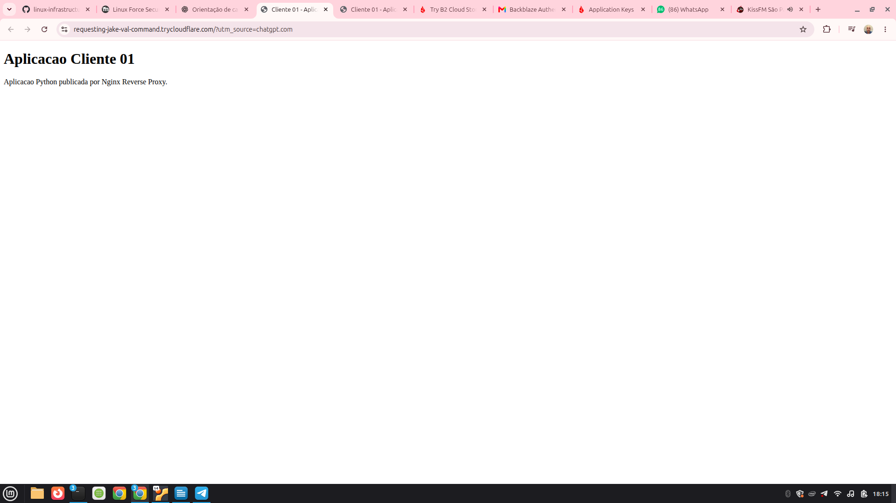
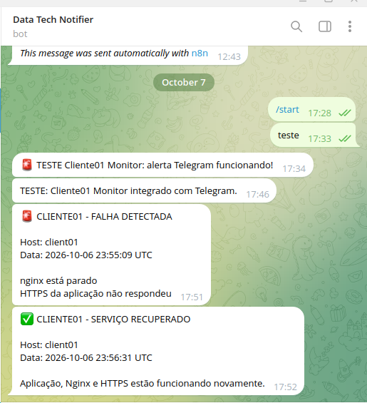

# Projeto Cliente01 — Infraestrutura Linux e VPS Gerenciada

## Objetivo

Implementar e administrar um ambiente Linux para hospedagem de uma aplicação Python, simulando a infraestrutura de um cliente e demonstrando competências práticas em Linux Administration, SysAdmin, automação, segurança, backup e monitoramento.

## Tecnologias utilizadas

- Ubuntu Server 26.04 LTS em máquina virtual VirtualBox
- Python 3 — aplicação web demonstrativa
- systemd — gerenciamento de serviços e timers
- Nginx — reverse proxy
- HTTPS/TLS — certificado autoassinado no laboratório
- UFW — firewall
- Bash — automação de tarefas
- rclone e Backblaze B2 — backup externo
- Telegram Bot API — notificações de monitoramento
- Cloudflare Quick Tunnel — demonstração de acesso externo

## Arquitetura

Cliente HTTP/HTTPS -> Nginx -> Aplicação Python (127.0.0.1:8000)

A aplicação é executada como serviço systemd, com usuário dedicado. O Nginx encaminha as requisições para a aplicação local. O acesso HTTP é redirecionado para HTTPS.

## Recursos implementados e testados

- Aplicação Python executada por serviço systemd e habilitada na inicialização.
- Nginx configurado como proxy reverso.
- HTTPS local com certificado autoassinado.
- Firewall UFW com regras para SSH, HTTP e HTTPS.
- Backup automatizado em armazenamento local e Backblaze B2.
- Teste de restauração dos arquivos de backup.
- Health-check periódico da aplicação, Nginx e endpoint HTTPS.
- Alertas de falha e recuperação enviados pelo Telegram.
- Validação dos serviços e timers após reinicialização da VM.
- Demonstração de acesso externo com Cloudflare Quick Tunnel.

## Limitações do ambiente

Este é um projeto de laboratório e prova de conceito, não uma implantação pronta para produção. O certificado TLS de origem é autoassinado; o Quick Tunnel utiliza endereço temporário e não oferece uma publicação permanente. A implantação em produção exigiria domínio, configuração de publicação estável, gestão de certificados, controles adicionais de segurança e procedimentos operacionais adequados.

## Aplicabilidade profissional

O projeto demonstra uma base prática para prestação de serviços de implantação e administração de aplicações em servidores Linux, configuração de proxy reverso, automação de backups, monitoramento e suporte operacional.

## Próximas etapas

- Registrar evidências dos testes e configurações.
- Documentar os scripts, serviços e timers.
- Elaborar um procedimento de implantação e recuperação.
- Avaliar uma futura implantação em VPS pública com domínio próprio.

## Evidências do Projeto

### Aplicação publicada com acesso externo

A aplicação Python foi acessada pelo navegador utilizando um endereço HTTPS temporário fornecido pelo Cloudflare Quick Tunnel.

Este teste demonstrou o funcionamento da integração entre Cloudflare, Nginx e a aplicação Python no ambiente de laboratório.

### Monitoramento com alertas no Telegram

Foi realizado um teste controlado de indisponibilidade do Nginx.

O health-check identificou a falha e enviou uma notificação pelo Telegram. Após a restauração do serviço, uma segunda notificação confirmou a recuperação da aplicação e do HTTPS.

### Backups automatizados no Backblaze B2

O projeto utiliza systemd timers e rclone para realizar backups locais e remotos.

Em 12/10/2026, foi confirmada a existencia de arquivos no Backblaze B2 referentes aos dias 07, 08, 09, 10 e 12 de outubro de 2026.

Comando de verificacao: `sudo rclone lsl backblaze:cliente01-backups-ryan/cliente01 | tail -n 5`

A listagem confirma o armazenamento remoto. O teste de restauracao foi realizado separadamente.

### Automacao com systemd

O projeto utiliza servicos e timers do systemd para executar tarefas automaticamente.

- **Aplicacao:** cliente01-app.service, habilitado na inicializacao da VM.
- **Backup:** cliente01-backup.timer, agendado diariamente para 05:00 UTC (02:00 de Brasilia), com Persistent=true para recuperar execucoes agendadas perdidas.
- **Monitoramento:** cliente01-healthcheck.timer, iniciado aproximadamente 2 minutos apos o boot, com verificacoes aproximadamente a cada 5 minutos.

Os timers foram verificados com systemctl list-timers e systemctl cat.
